# Architecture

## Runtime data flow

```mermaid
flowchart LR
    User[User]
    UI[Angular chat UI<br/>localhost:4200]
    API[Python FastAPI<br/>localhost:8000]
    OCR[Tesseract OCR<br/>scanned PDF pages]
    PDF[PDF text extraction<br/>pypdf]
    Chunk[Page-aware chunking<br/>1200 chars, 180 overlap]
    Embed[Ollama embeddings<br/>nomic-embed-text]
    Chat[Ollama chat model<br/>llama3.2]
    Qdrant[(Qdrant collection<br/>banking-pdf-chunks)]
    Volume[(Persistent Docker volume<br/>qdrant_storage)]
    Java[Optional Spring Boot proxy<br/>localhost:8080]

    User --> UI
    UI -->|POST /documents| API
    UI -->|POST /chat| API

    API --> PDF
    PDF -->|no selectable text| OCR
    PDF --> Chunk
    OCR --> Chunk
    Chunk -->|text chunks| Embed
    Embed -->|vectors + source metadata| Qdrant
    Qdrant --- Volume

    API -->|embed question| Embed
    Embed -->|query vector| Qdrant
    Qdrant -->|top 5 passages| API
    API -->|question + retrieved context| Chat
    Chat -->|answer with source references| API
    API --> UI

    UI -. currently bypassed .-> Java
    Java -. optional proxy to Python /chat .-> API
```

## What is stored

Qdrant stores each text chunk, its embedding vector, PDF filename, page number, chunk index, and a hash identifying the PDF content. The original PDF file is not saved by the Python service. Qdrant persists its collection in the Docker volume.

## Current limits

- The Angular UI calls Python directly; Java is not currently in the active UI request path.
- Planned for version 2: route UI requests through Java and strengthen centralized validation for chat requests and uploaded PDFs.
- There is no bank-account integration, authentication, user-specific document access, or document deletion UI.
- Retrieval returns up to five nearest passages; the project has not yet been evaluated with a retrieval-quality test set.
- OCR accuracy depends on scan quality and the installed Tesseract language data.
